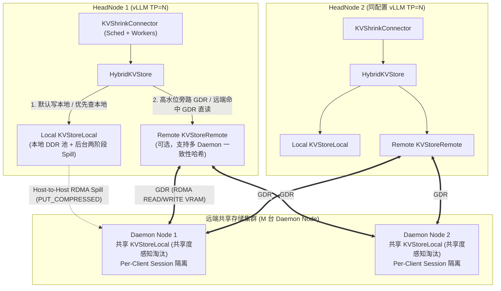

# 多 HeadNode 跨节点共享与混合分层 KV Cache 方案设计

**适用分支**：`mix_usage`
**关联文档**：
- [本地模式说明](../../README.zh-CN.md)
- [remote_pool 使用文档](../usage/remote-pool-kvstore.zh-CN.md)
- [remote_pool 架构设计](remote-pool-kvstore.zh-CN.md)
- [DDR 内存池自动淘汰设计](eviction.md)

---

## 一、背景与目标

当前 `iaxl` 提供了两种互斥的 KV Cache 存取复用方式：
1. **本地 HeadNode DDR 模式（`IAXL_RDMA_ENABLE=0`）**：通过 CUDA / Intel DSA 将 KV Cache 导出至本机 DDR 内存池，结合 QAT / IAA / CPU 进行压缩与复用，并通过后台水位线程执行异步 LRU 淘汰（`ecc4bcd1`）。
2. **远端 `remote_pool` 模式（`IAXL_RDMA_ENABLE=1`）**：通过 GPU Direct RDMA（GDR）将 KV Cache 直接读写至无 GPU 的远端存储 Daemon 节点的 DDR 池，当前仅支持单个 HeadNode 独占连接。

本方案将两种方式整合为**“HeadNode 本地独享 DDR + 远端共享存储集群”的两级混合分层架构（`HybridKVStore`）**，支持多个同配置 HeadNode 并发接入远端共享池并实现 KV Cache 跨节点复用，同时完全向后兼容原有的纯本地与纯远端模式。

---

## 二、运行模式矩阵

通过 `IAXL_RDMA_ENABLE` 与 `IAXL_DDR_POOL_SIZE_GB` 两个环境变量组合，无缝覆盖三种运行模式：

| `IAXL_RDMA_ENABLE` | `IAXL_DDR_POOL_SIZE_GB` | 运行模式 | 行为说明 |
| :--- | :--- | :--- | :--- |
| **`0`** | `> 0` 或未设（默认） | **纯本地模式** | 完全沿用现有 `KVStoreLocal` 逻辑（本地 DDR + 现有异步 LRU 淘汰 / Persist） |
| **`1`** | **`0`** | **纯远端模式** | 跳过本地 `KVStoreLocal` 与本机绑核/绑卡，全部直连远端 Daemon（GDR 读写） |
| **`1`** | `> 0` 或未设 | **混合分层模式（Hybrid）** | 本地 DDR 为主（默认写本地、优先查本地、水线异步 Spill 压缩块至远端）；本地高水位/超容时 GDR 直写远端；远端命中时 GDR 直读不回填本地 |

---

## 三、总体架构



---

## 四、核心设计细节

### 4.1 跨 HeadNode 共享与 Hash 一致性
1. **Hash 生成一致**：所有共享同一远端存储集群的 HeadNode 必须使用相同的 `MODEL`、`TP_SIZE`、`block_size`、`dtype`、`prefix_caching_hash_algo`，并统一固定 `PYTHONHASHSEED`（例如 `PYTHONHASHSEED=42`）。
2. **逻辑 Key 无状态化**：远端共享池内的逻辑键仅由 `(model_name, tp_size, rank, layer_key, block_hash)` 组成，不包含 `client_id`，确保任一 HeadNode 写入或 Spill 的 KV Cache 可被其他 HeadNode 命中。
3. **压缩格式对齐**：所有 HeadNode 与远端 Daemon 需保持一致的压缩参数（`IAXL_KV_COMPRESSION`、`IAXL_KV_DATA_SHUFFLE`、`IAXL_ZIP_EXPONENT_ONLY`），使本地已压缩块无需重压缩即可直接存入远端并在他机正常解压。

---

### 4.2 远端 Daemon 多 HeadNode 并发支持

改造 `iaxl/remote_pool/rpc.py` 中的 `KVStoreService`，从“单 Client 独占”升级为“**共享存储实例 + Per-Client `ClientSession` 隔离**”：

1. **NIXL Agent 命名隔离**：Client 侧构造唯一 `client_id`（默认 `<hostname>_<pid>`，也可通过 `IAXL_CLIENT_ID` 指定），Agent 名格式为 `client_<client_id>_sched` 与 `client_<client_id>_r<rank>`，避免多 HeadNode 建连时 Agent 名称冲突。
2. **隔离控制面缓冲区（`ctrl_buf`）**：每个 Daemon RPC 进程启动时预注册 16 个 4 MiB 缓冲区（每进程 64 MiB）。`_hello` 为 peer 分配一个 slot，并在 `HELLO` 响应中返回该 slot 的 `(base, bytes, client_slot)`；`serve()` 按 peer 读取对应 Session 的 `ctrl_np`。Session 释放后 slot 可复用。当前单进程最多支持 16 个并发 peer。
3. **显存注册与 `pool_keys` 路由隔离**：
   - Daemon 侧 `register_kv_pool_remote` 使用 `f"{peer}:{layer_name}"` 作为 C++ `KVPool` 注册键，记录在 `session.pool_keys` 中。
   - `KVFlow.put()` 与 `KVFlow.get()` 新增可选参数 `pool_keys`：传输上下文 `_create_ctx()` 使用 `f"{peer}:{layer_name}"` 定位目标 HeadNode 的 GPU 显存，而 `Mem` 内部存储仍使用统一的 `layer_name`（`"0"`, `"1"`, ...），实现**底层显存地址隔离 + 上层共享 DDR 池**。
4. **`ScratchPool` 共享**：同一 Daemon rank 上的 HeadNode 请求共享该进程的 `IAXL_SCRATCH_POOL_SIZE_GB` 中转池。当前实现尚未执行 per-peer 的 ScratchPool 单次/在途配额背压，因此大请求仍可能与其他 HeadNode 竞争中转资源。
5. **独立生命周期管理**：某 HeadNode 下线发送 `UNREGISTER` 或 `STOP` 时，Daemon 仅释放该 `peer` 的 `RemoteTensor`、`ctrl_buf` 注册及在途任务，**不关闭共享 `KVStoreLocal` 进程**，不影响其他 HeadNode 正常服务。

---

### 4.3 HeadNode 双通道初始化与优雅降级

1. **双通道初始化**：在混合模式下（`IAXL_RDMA_ENABLE=1` 且 `IAXL_DDR_POOL_SIZE_GB > 0`），`HybridKVStore` 先初始化本地 `KVStoreLocal`，并在 `try ... except` 中尝试连接远端 `KVStoreRemote`。
2. **资源绑定修正**：混合模式下本地仍承担压缩/解压任务，因此 `KVShrinkConnector` 仅在纯远端模式（`IAXL_RDMA_ENABLE=1` 且 `IAXL_DDR_POOL_SIZE_GB == 0`）下跳过 `_bind_cpu_affinity()` 与 `_bind_intel_accel()`。
3. **远端可选与故障降级**：若未配置 `IAXL_RDMA_DAEMON_NIC_IPS` 或建连超时/运行期断连，`HybridKVStore` 自动将远端通道标记为不可用并降级为纯本地模式，保障推理服务不中断。

---

### 4.4 两级查找、并行读取与不回填策略

1. **两级前缀匹配（Scheduler）**：
   - 先查询 `local.has(block_hashes)` 得到本地连续命中前缀长度 $k$；
   - 若 $k < N$ 且远端可用，仅对剩余后缀 `block_hashes[k:]` 查询 `remote.has()`，得到远端连续命中长度 $m$。
2. **并行加载（Worker）**：
   - 前 $k$ 块由 `local.get()`（CPU/DSA H2D）加载，后 $m$ 块由 `remote.get()`（NIC GDR WRITE）加载；两条物理通路独立，同时提交并汇总等待完成。
3. **远端命中不回填本地**：
   - 依据 `/mnt/data/zengjun/KV_CACHE/compare_local_vs_remote_v3_4.xlsx` 实测数据（高并发下 `con=16, hit=80%` 本地 685ms vs 远端 707ms 仅差 ~3%，`hit=100%` 远端甚至更优），远端命中块直接通过 GDR 写入 GPU 显存，**不在本地 DDR 重复存储**，避免挤占本地独享缓存容量与 PCIe 带宽。

---

### 4.5 前台 GDR 直写与后台两阶段 Spill（结合 `ecc4bcd1`）

#### （1）前台请求级写入路由（`put`）
为避免本地 DDR 紧张时发生写入-淘汰抖动，在请求开始写入前做一次统一路由判断（同一请求所有层走同一目标）：
- **条件 A（高水位旁路）**：本地 DDR 使用率 $\ge$ `IAXL_DDR_POOL_SPILL_HIGH_WATERMARK`（默认 `0.75`）或 `EVICT_HIGH_WATERMARK` 时，直接通过 `remote.put()` 经 GDR 写入远端。
- **条件 B（单请求超容旁路）**：单次请求的 KV 估算字节数超过本地 DDR 剩余可用空间，或超过本地总容量的 `IAXL_HYBRID_BYPASS_SINGLE_REQ_RATIO`（默认 `0.30`）时，直接通过 GDR 写入远端。
- 其余情况默认写入本地 DDR。

#### （2）结合 `ecc4bcd1` 异步淘汰框架的后台两阶段 Spill
复用 `KVStoreLocal._monitor_loop` 监控 rank 0 水位与多 rank 一致性广播框架，但针对网络 Spill 特性做两项关键改进：
1. **更敏感的水位与检查周期**：新增 `IAXL_DDR_POOL_SPILL_HIGH_WATERMARK`（默认 `0.75`）、`IAXL_DDR_POOL_SPILL_LOW_WATERMARK`（默认 `0.60`）与 `IAXL_DDR_POOL_SPILL_INTERVAL_S`（默认 `5s`），早于 `EVICT_HIGH_WATERMARK=0.90` 触发，避免突发流量下 Spill 不及时；`0.90` 仍作为兜底强淘汰线。
2. **两阶段无阻塞迁移**：
   - **阶段一（只读传输，不阻塞 `has()`）**：选出最老的 LRU Group，先调 `remote.has()` 去重；对远端缺失的块，直接通过 `Mem.get()` 读取本地**已压缩的字节流**，经 `PUT_COMPRESSED` RPC（Host-to-Host RDMA）写入远端 DDR 池（远端跳过解压与重压缩，直接调用 `Mem.put()` 落池）。此阶段不加入 `self._evicting`，完全不阻塞前台 `has()` 和 `get()`。
   - **阶段二（快速摘除）**：收到远端落池确认后，再将这批 `labels` 加入 `self._evicting`，广播 `/v1/cache/evict_labels` 同步释放各 rank 本地 DDR 内存。
3. **本地热点镜像（可选）**：当本地块命中次数达到 `IAXL_HYBRID_PROMOTE_HIT_COUNT`（默认 `2`）且尚未同步到远端时，后台异步通过 `PUT_COMPRESSED` 镜像一份至远端，使真正高频的公共前缀得以跨节点共享。

---

### 4.6 远端共享度感知淘汰策略

在远端共享 Daemon 的 Scheduler 侧（`shared_mode=True`）：
- 为每个 `group_key` 维护 `(accessor_mask, access_count, last_access)`，其中 `accessor_mask` 为访问过该块的 HeadNode `client_slot` 位图。
- 达到远端高水位需要淘汰/Persist 时，按 **`(共享节点数 popcount(accessor_mask) 升序, 总访问次数 access_count 升序, 最近访问时间 last_access 升序)`** 排序：
  - 优先淘汰仅由单一节点 Spill 过来的冷数据；
  - 优先保留被多个 HeadNode 共同频繁访问的公共热点 KV Cache。

---

### 4.7 远端存储集群化（一致性哈希分片）

1. **多节点配置语法**：`IAXL_RDMA_DAEMON_NIC_IPS` 使用 `|` 分隔多个远端 Daemon 节点，节点内部仍用 `,` 分隔该节点的多张 RDMA 网卡 IP，并支持可选 `:port`（默认取 `IAXL_RDMA_DAEMON_PORT`）：
   ```bash
   # 示例：2 台 Daemon 节点（节点1单网口，节点2双网口）
   export IAXL_RDMA_DAEMON_NIC_IPS="10.10.10.10|10.10.10.12,10.10.11.12"
   ```
   Client 端对每个节点仅需取列表第 0 个 IP 作为控制面连接目标，数据面多网口 GID 由 NIXL 元数据交换自动完成。
2. **Block 一致性哈希分片**：每个 block 独立以自身 `block_hash` 通过一致性哈希映射到 Daemon，确保前台 `has()` / `get()` / `put()` 与后台 LRU Spill 对同一 block 的路由一致。按目标 Daemon 分组下发请求，完成后按原顺序合并命中结果；每层聚合所有涉及节点的 `RemoteTask`。该实现不提供 super-block 亲和性，可能增加跨节点小请求数量。

---

## 五、当前限制

- **不支持 Daemon 节点的动态增减**：`KVStoreRemote` 只在初始化时解析一次 `IAXL_RDMA_DAEMON_NIC_IPS`，`ConsistentHashRing` 使用节点在 `|` 列表中的**位置序号**（`node{idx}#{vnode}`）而不是地址建环，运行期不感知集群成员变化。增减 Daemon 节点（或调整列表顺序）必须修改所有 HeadNode 配置并重启，之后部分 block 的 `node_for(block_hash)` 结果改变（删除中间节点会让后续节点序号整体前移，影响范围更大），已存储在原节点上的 KV Cache 无法再被 `has()` / `get()` 匹配到，导致命中率下降并重新计算。当前没有数据迁移 / 重平衡机制，原节点上的旧数据只能等待 LRU 淘汰。
