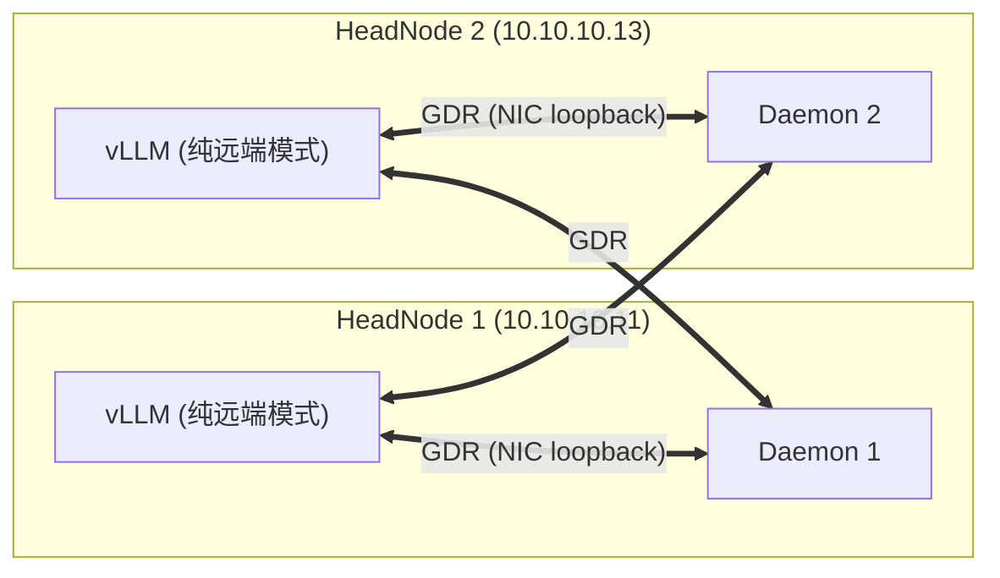

# 多 HeadNode 跨节点共享与混合分层 KV Cache —— 使用指南

**设计文档**：[multi-headnode-hybrid-kvcache.zh-CN.md](../design/multi-headnode-hybrid-kvcache.zh-CN.md)
**适用分支**：`mix_usage`

---

## 一、运行模式总览

通过 `IAXL_RDMA_ENABLE` 与 `IAXL_DDR_POOL_SIZE_GB` 两个环境变量的组合，控制 HeadNode 的 KV Cache 运行模式：

| `IAXL_RDMA_ENABLE` | `IAXL_DDR_POOL_SIZE_GB` | 运行模式 | 说明 |
| :--- | :--- | :--- | :--- |
| `0` | `> 0` 或未设 | **纯本地模式** | 仅使用本机 DDR + 现有 LRU 淘汰，与既有行为完全一致 |
| `1` | `0` | **纯远端模式** | 跳过本地 DDR 与本机 QAT/DSA 绑核，所有读写通过 GDR 直连远端 Daemon |
| `1` | `> 0` 或未设 | **混合分层模式（Hybrid）** | 本地 DDR 为主（默认写本地、优先查本地、水线异步 Spill 压缩块到远端）；本地高水位/超容时 GDR 旁路直写远端；远端命中时 GDR 直读不回填 |

---

## 二、关键环境变量

| 变量 | 默认值 | 适用端 | 说明 |
| :--- | :--- | :--- | :--- |
| `PYTHONHASHSEED` | 无（**多机必设**） | 所有 HeadNode | **必须配置为相同值**（如 `42`），保证不同 HeadNode 生成一致的 `block_hash` |
| `IAXL_RDMA_ENABLE` | `0` | Daemon & HeadNode | 设为 `1` 开启远端 / 混合模式 |
| `IAXL_DDR_POOL_SIZE_GB` | RAM 的 80% / rank | Daemon & HeadNode | HeadNode 设为 `0` 表示纯远端；`> 0` 表示混合模式下的本地 DDR 容量/rank |
| `IAXL_RDMA_DAEMON_NIC_IPS` | 空 | Daemon & HeadNode | Daemon 节点只需填本机 RDMA IP（多网口用 `,` 分隔）；HeadNode 填所有远端 Daemon，**多台 Daemon 用 `\|` 分隔**，支持可选 `:port` |
| `IAXL_RDMA_CLIENT_NIC_IPS` | 空 | HeadNode | 本机 RDMA 网卡 IP 列表（多网口用 `,` 分隔） |
| `IAXL_CLIENT_ID` | `<hostname>_<pid>` | HeadNode | 可选，用于多 HeadNode 接入同一 Daemon 时区分 NIXL Agent 身份 |
| `IAXL_DDR_POOL_SPILL_HIGH_WATERMARK` | `0.75` | HeadNode（混合模式） | 本地 DDR 达到该比例时触发两阶段后台 Spill 到远端，且新请求直接 GDR 旁路写远端 |
| `IAXL_DDR_POOL_SPILL_LOW_WATERMARK` | `0.60` | HeadNode（混合模式） | 后台 Spill 将本地 DDR 降回该比例 |
| `IAXL_DDR_POOL_SPILL_INTERVAL_S` | `5` | HeadNode（混合模式） | 后台 Spill 检查周期（秒） |
| `IAXL_HYBRID_BYPASS_SINGLE_REQ_RATIO` | `0.30` | HeadNode（混合模式） | 单请求估算 KV 大小超过本地 DDR 池该比例时直接走 GDR 写远端 |
| `IAXL_HYBRID_PROMOTE_HIT_COUNT` | `2` | HeadNode（混合模式） | 本地块被命中达到该次数后异步镜像至远端共享池（`0` 关闭） |
| `IAXL_SCRATCH_POOL_SIZE_GB` | `8`（示例值） | Daemon | 每个 Daemon rank 的共享中转池容量；当前没有 per-HeadNode 配额隔离 |

---

## 三、部署步骤（示例：2 台 HeadNode + 2 台远端 Daemon 集群）

### 3.1 启动远端 Daemon 存储集群

在每台无 GPU 的存储节点上启动 Daemon（节点 A：`10.10.10.10`，节点 B：`10.10.10.12,10.10.11.12`）：

```bash
# ---- 存储节点 A (10.10.10.10) ----
NVIDIA_RUNTIME=none ./start.sh
# 容器内执行：
export IAXL_RDMA_ENABLE=1
export IAXL_RDMA_DAEMON_NIC_IPS=10.10.10.10
export IAXL_RDMA_DAEMON_PORT=5555
export IAXL_RDMA_TP_SIZE=4
export TP_SIZE=4
export IAXL_KV_COMPRESSION=1
export IAXL_QAT_ZIP_ENABLE=1
export KVSHRINK_QAT_DEVICES="0|1|4|5"
export IAXL_DDR_POOL_SIZE_GB=64
./examples/kvshrink-daemon.sh
```

```bash
# ---- 存储节点 B (双网口 10.10.10.12, 10.10.11.12) ----
NVIDIA_RUNTIME=none ./start.sh
# 容器内执行：
export IAXL_RDMA_ENABLE=1
export IAXL_RDMA_DAEMON_NIC_IPS=10.10.10.12,10.10.11.12
export IAXL_RDMA_DAEMON_PORT=5555
export IAXL_RDMA_TP_SIZE=4
export TP_SIZE=4
export IAXL_KV_COMPRESSION=1
export IAXL_QAT_ZIP_ENABLE=1
export KVSHRINK_QAT_DEVICES="0|1|4|5"
export IAXL_DDR_POOL_SIZE_GB=64
./examples/kvshrink-daemon.sh
```

> **提示**：Daemon 侧会自动开启共享度感知淘汰策略（`shared_mode=True`），优先保留被多个 HeadNode 频繁复用的公共 KV Cache。若只部署单台 Daemon，后续 HeadNode 侧 `IAXL_RDMA_DAEMON_NIC_IPS` 只需填写该单台节点的 IP 即可。

---

### 3.2 启动多个 HeadNode（混合分层模式）

在 HeadNode 1（`10.10.10.11`）和 HeadNode 2（`10.10.10.13`）上分别启动 vLLM 服务。**两台机器的 `MODEL`、`TP_SIZE`、`PYTHONHASHSEED` 和压缩配置必须保持一致**：

```bash
# ---- HeadNode 1 (10.10.10.11) ----
./start.sh
# 容器内执行：
export PYTHONHASHSEED=42
export MODEL=Qwen/Qwen3-32B
export TP_SIZE=4

# 开启混合分层模式：本地 DDR 16GB/rank + 远端双节点集群
export IAXL_RDMA_ENABLE=1
export IAXL_DDR_POOL_SIZE_GB=16
export IAXL_RDMA_DAEMON_NIC_IPS="10.10.10.10|10.10.10.12"
export IAXL_RDMA_CLIENT_NIC_IPS="10.10.10.11"
export IAXL_RDMA_DAEMON_PORT=5555
export IAXL_RDMA_TP_SIZE=4
export IAXL_CLIENT_ID="headnode1"

# 本地加速器与压缩配置（需与 Daemon 对齐）
export IAXL_KV_COMPRESSION=1
export IAXL_QAT_ZIP_ENABLE=1
export IAXL_DSA_GD_ENABLE=1

# 混合模式水位与 Spill 配置
export IAXL_DDR_POOL_SPILL_HIGH_WATERMARK=0.75
export IAXL_DDR_POOL_SPILL_LOW_WATERMARK=0.60
export IAXL_DDR_POOL_SPILL_INTERVAL_S=5
export IAXL_HYBRID_PROMOTE_HIT_COUNT=2

./examples/kvshrink-vllm-serve.sh
```

HeadNode 2 只需将 `IAXL_RDMA_CLIENT_NIC_IPS="10.10.10.13"` 与 `IAXL_CLIENT_ID="headnode2"` 替换后以相同方式启动即可。

> **远端可选降级**：如果未配置 `IAXL_RDMA_DAEMON_NIC_IPS` 或启动时远端 Daemon 尚未就绪，HeadNode 会自动打印告警并降级为纯本地 DDR 模式继续提供推理服务。

---

### 3.3 启动纯远端模式（可选）

如果希望 HeadNode 不占用本机 DDR 和 QAT/DSA 资源，全部 KV Cache 直接通过 GDR 存取远端共享集群，只需将 `IAXL_DDR_POOL_SIZE_GB` 设为 `0`：

```bash
export PYTHONHASHSEED=42
export IAXL_RDMA_ENABLE=1
export IAXL_DDR_POOL_SIZE_GB=0
export IAXL_RDMA_DAEMON_NIC_IPS="10.10.10.10|10.10.10.12"
export IAXL_RDMA_CLIENT_NIC_IPS="10.10.10.11"
export IAXL_RDMA_TP_SIZE=4
export TP_SIZE=4
./examples/kvshrink-vllm-serve.sh
```

---

### 3.4 无专用存储节点：多 HeadNode 对等部署（Daemon 与 vLLM 同机）

不部署专门的远端存储节点，而是在**每台 HeadNode 上同时运行一个 Daemon 和一个纯远端模式（`IAXL_DDR_POOL_SIZE_GB=0`）的 vLLM**。所有 HeadNode 的 Daemon 共同组成一个共享 KV Cache 池，各 HeadNode 的 GPU worker 通过一致性哈希把 block 分散存放到所有节点（包括本机）的 Daemon 中，从而实现跨 HeadNode 的 KV Cache 复用。



**部署步骤**（以 2 台 HeadNode、TP=4 为例）：

1. **先在所有节点上启动 Daemon**。纯远端模式下 vLLM 启动时会连接列表中的全部 Daemon，任一节点连接失败都会导致 vLLM 启动失败（不会像混合模式那样降级为纯本地）。

   ```bash
   # ---- HeadNode 1 上的 Daemon（独立 shell / 容器，环境变量勿与 vLLM 混用）----
   export IAXL_RDMA_ENABLE=1
   export IAXL_RDMA_DAEMON_NIC_IPS=10.10.10.11      # 只填本机 RDMA IP
   export IAXL_RDMA_DAEMON_PORT=5555
   export IAXL_RDMA_TP_SIZE=4
   export TP_SIZE=4
   export IAXL_DDR_POOL_SIZE_GB=64                  # Daemon 每 rank 的共享 DDR 池容量
   export IAXL_KV_COMPRESSION=1
   export IAXL_QAT_ZIP_ENABLE=1
   # Daemon 承担全部压缩/解压，建议绑定到 vLLM 进程不使用的 CPU 与 QAT 设备
   export VLLM_CPU_OMP_THREADS_BIND="0-8|18-26|36-44|54-62"
   export KVSHRINK_CPU_OMP_THREADS_BIND="$VLLM_CPU_OMP_THREADS_BIND"
   export KVSHRINK_QAT_DEVICES="0|1|4|5"
   ./examples/kvshrink-daemon.sh
   ```

   HeadNode 2 上将 `IAXL_RDMA_DAEMON_NIC_IPS` 改为 `10.10.10.13` 后以相同方式启动。

2. **所有 Daemon 就绪后，再在每台节点上启动纯远端模式的 vLLM**：

   ```bash
   # ---- HeadNode 1 上的 vLLM ----
   export PYTHONHASHSEED=42
   export MODEL=Qwen/Qwen3-32B
   export TP_SIZE=4
   export IAXL_RDMA_ENABLE=1
   export IAXL_DDR_POOL_SIZE_GB=0                   # 纯远端：不使用本机 KVStoreLocal
   export IAXL_RDMA_DAEMON_NIC_IPS="10.10.10.11|10.10.10.13"   # 所有节点的 Daemon（含本机），各节点顺序必须一致
   export IAXL_RDMA_CLIENT_NIC_IPS="10.10.10.11"
   export IAXL_RDMA_DAEMON_PORT=5555
   export IAXL_RDMA_TP_SIZE=4
   export IAXL_CLIENT_ID="headnode1"
   ./examples/kvshrink-vllm-serve.sh
   ```

   HeadNode 2 只需将 `IAXL_RDMA_CLIENT_NIC_IPS` 与 `IAXL_CLIENT_ID` 替换为本机值，`IAXL_RDMA_DAEMON_NIC_IPS` 保持**完全相同的顺序**。

**注意事项**：

- **一致性要求**：所有节点的 Daemon 与 vLLM 的 `TP_SIZE` / `IAXL_RDMA_TP_SIZE` 必须一致；`PYTHONHASHSEED`、模型及压缩参数要求同 3.2 节。
- **端口**：Daemon 占用 `IAXL_RDMA_DAEMON_PORT` 至 `IAXL_RDMA_DAEMON_PORT + TP_SIZE`，以及管理端口 `IAXL_API_CONTROLLER_PORT`（默认 `18700`）和 `IAXL_API_WORKER_BASE_PORT + rank`（默认 `18800+`）。纯远端模式的 vLLM 不启动管理服务，因此与本机 Daemon 不冲突；此时本机 `18700` 返回的是 **Daemon** 的状态。
- **资源隔离**：纯远端模式的 vLLM 不做 iaxl 的 CPU/QAT 绑定，压缩/解压全部在 Daemon 上完成；应为 Daemon 预留独立的 CPU 核与 QAT 设备，并根据本机内存规划 `IAXL_DDR_POOL_SIZE_GB`（每 rank）与 `IAXL_SCRATCH_POOL_SIZE_GB`，避免影响 vLLM。
- **本机数据仍走 RDMA**：路由到本机 Daemon 的 block（约占 $1/N$）同样经 NIC loopback 以 GDR 读写，没有进程内的短路路径；其余 block 经网络访问其他节点。
- **故障影响**：某台 HeadNode 宕机时其 Daemon 一同下线，该节点上存放的 KV Cache 分片丢失；其余 HeadNode 对该分片的访问会失败。恢复时需按原顺序、原地址重启该节点 Daemon（见第五章限制）。

**验证结果**（`logs_multi_hn_colo_20261124_035716`）：在单台 4 GPU 主机上模拟 2 个对等节点（Daemon A + HN1 使用 GPU 0,1；Daemon B + HN2 使用 GPU 2,3；TP=2，Qwen2.5-32B，8000 token 输入，两个 HN 均为 `IAXL_DDR_POOL_SIZE_GB=0`，`IAXL_RDMA_DAEMON_NIC_IPS="10.10.10.11:5555,10.10.11.11|10.10.10.11:6555,10.10.11.11"`）：

| 用例 | 外部命中 token / 请求 | 平均 TTFT |
| :--- | :--- | :--- |
| HN2 全新请求（基线） | 0 | 5163.5 ms |
| HN1 首次计算并写入 | 0 | 5168.4 ms |
| HN2 发送与 HN1 相同的请求 | 7984 | 243.9 ms |
| HN1 再次发送相同请求 | 7984 | 232.6 ms |

两个 Daemon 分别保存了 3215 / 2773 个 group，所有日志无报错。该测试验证了同机 Daemon + 纯远端 vLLM、NIC loopback GDR 与跨 HeadNode 复用；跨主机 GDR 路径已由前面的 2 HeadNode + 1/2 Daemon 测试覆盖。

---

## 四、状态验证

在任意 HeadNode 上通过管理接口查看本地与远端混合连接状态：

```bash
curl -s http://localhost:18700/v1/cache/status | jq '.workers["0"] | {current_bytes, capacity_bytes, hybrid, remote: .remote.current_bytes}'
```

- `hybrid.remote_connected` 为 `true` 表示远端通道已就绪；`remote.current_bytes` 和 `remote.capacity_bytes` 在多 Daemon 集群中是所有节点的合计；
- 当本地 DDR 使用率达到 `0.75` 时，日志中会出现 `[spill] migrated N groups to remote DDR`，表示两阶段后台 Spill 正在将本地冷压缩块平滑迁移至远端共享池。

---

## 五、当前限制

- **不支持 Daemon 节点的动态增减**：HeadNode 只在启动时解析一次 `IAXL_RDMA_DAEMON_NIC_IPS`，并按各节点在 `|` 列表中的**位置序号**（而不是 IP）构建一致性哈希环。运行期增减 Daemon 节点无法被感知；修改列表（增加、删除或调整顺序）后必须重启所有 HeadNode。重启后部分 block 会映射到其他节点（删除中间节点会让后续节点序号整体前移，影响范围更大），原节点上已存储的 KV Cache 无法被 `has()` / `get()` 查找到，表现为命中率下降并重新计算。当前没有数据迁移 / 重平衡机制，原节点上的旧数据只能等待 LRU 淘汰。
